# CabSafe — SOS Lifecycle & Trigger Architecture

This document describes the exact implementation of `AnomalyDetector.triggerSOS()` and its downstream paths, distinguishing local browser simulation from backend AWS integration.

---

## 1. Architectural Flowchart

```mermaid
flowchart TD
    subgraph Callers["1. Callers"]
        CallerA["Background Drills & Escalations\n(SimulationEngine.ts:205, AnomalyDetector.ts:331/344)\npersistToBackend = false"]
        CallerB["Manual Test Button (handleTriggerManualSOS)\n(SOSPage.tsx:27)\npersistToBackend = true"]
    end

    subgraph EntryAndGuards["2. AnomalyDetector.triggerSOS()"]
        Start["triggerSOS(cabId, reason, severity, persistToBackend)\nAnomalyDetector.ts:200"]
        CheckCab{"Cab exists in\nstore.cabs?"}
        CheckGuard{"activeSosCabIds.has(cabId)\nOR cab.state == SOS?"}
        Reject["Log duplicate warning\nReturn early (No-op)"]
        GenID["Increment monotonic sosCounter\nBuild ID: EVT-SOS-{timestamp}-{sosCounter}"]
        AddLocal["Synchronous local updates:\n- store.addSOSRequest\n- store.updateCab(state: SOS)\n- store.addSafetyEvent\n- store.addAlert(EMERGENCY)"]
    end

    CallerA --> Start
    CallerB --> Start
    Start --> CheckCab
    CheckCab -- "No" --> ExitDrop["Drop call (Silent return)"]
    CheckCab -- "Yes" --> CheckGuard
    CheckGuard -- "Yes (Duplicate)" --> Reject
    CheckGuard -- "No" --> GenID
    GenID --> AddLocal

    AddLocal --> BranchLocalTimer["Path A: Local Simulation Timer\n(Client-side setTimeout 45-90s)"]
    AddLocal --> BranchBackendCheck{"Path B: Backend Check\npersistToBackend == true?"}

    subgraph LocalTimerPath["Path A: Local Simulation Lifecycle (Browser Memory Only)"]
        TimerWait["Timer fires after 45-90s delay"]
        CheckActive{"sosRequests has this\ncanonical ID with ACTIVE?"}
        TimerNoOp["Already resolved by operator\nNo action"]
        ApplyLocalResolve["Local session resolution:\n- store.updateSOSStatus(RESOLVED)\n- store.resolveSafetyEvent(canonicalIncidentId)"]
        CheckRemaining{"Any OTHER active SOS\nremain for this cab?"}
        KeepCabSOS["Keep cab in SOS state\nKeep cabId in activeSosCabIds"]
        ResetCab["Reset cab to ON_TRIP\nClear activeAnomaly & activeEventId\nRemove cabId from activeSosCabIds"]
        LocalOnlyNote["NOTE: Local timer resolves browser session only.\nIt makes ZERO network calls and NEVER updates RDS."]
    end

    BranchLocalTimer --> TimerWait
    TimerWait --> CheckActive
    CheckActive -- "No" --> TimerNoOp
    CheckActive -- "Yes" --> ApplyLocalResolve
    ApplyLocalResolve --> CheckRemaining
    CheckRemaining -- "Yes" --> KeepCabSOS
    CheckRemaining -- "No" --> ResetCab
    ResetCab --> LocalOnlyNote

    subgraph BackendPath["Path B: Backend Persistence & AWS Integration"]
        BackendNoOp["Local-Only Drill:\nSkip safetyEventService.create()\nZero network/AWS activity"]
        CheckApiMode{"VITE_USE_API == true?"}
        MockRepo["MockSafetyEventRepository:\nIn-memory mock database only"]
        ApiRepo["ApiSafetyEventRepository.create():\nAttempt HTTP POST /events"]
        PostResult{"HTTP POST succeeded\n(2xx)?"}
        GetFallback["Attempt fallback HTTP GET\n/events?trigger_sos=true&..."]
        GetResult{"HTTP GET fallback\nsucceeded (2xx)?"}
        NetworkFail["Log warning\nOptimistic return on client\n(No backend persistence)"]
        ApiGateway["AWS API Gateway HTTP API\nRoutes to Lambda CabSafeAPI"]
        LambdaAuthCheck{"Foreign keys valid in RDS\n(cabs, users)?"}
        Lambda400["Lambda returns 400 Bad Request\nInsert aborted"]
        RdsInsert["Execute parameterized SQL:\nINSERT INTO safety_events ..."]
        RdsResult{"RDS MySQL insert\nsucceeded?"}
        Lambda500["Lambda returns 500\nDatabase error"]
        IotAttempt["Attempt AWS IoT Core publish\ncabsafe/telemetry/{cabId}"]
        IotCheck{"IoT Core publish\nsucceeded?"}
        IotWarn["Log IoT warning\n(Proceed with execution)"]
        LambdaInvoke["Attempt Lambda async invoke:\nCabSafeSOSNotifier (InvocationType: Event)"]
        InvokeCheck{"Lambda invoke\nsucceeded?"}
        InvokeWarn["Log invoke warning\nExecution finishes"]
        NotifierExecution["Lambda CabSafeSOSNotifier executes:\nAttempt SNS publish to CabSafe-Emergency-Alerts"]
        SnsCheck{"SNS publish\nsucceeded?"}
        SnsFail["Email delivery failed\n(Unconfirmed sub or SNS error)"]
        SnsSuccess["SNS delivers email to\nverified subscribers"]
    end

    BranchBackendCheck -- "false (Routine Drill)" --> BackendNoOp
    BranchBackendCheck -- "true (Manual Test)" --> CheckApiMode
    CheckApiMode -- "false" --> MockRepo
    CheckApiMode -- "true" --> ApiRepo
    ApiRepo --> PostResult
    PostResult -- "Yes" --> ApiGateway
    PostResult -- "No / Error" --> GetFallback
    GetFallback --> GetResult
    GetResult -- "Yes" --> ApiGateway
    GetResult -- "No / Error" --> NetworkFail

    ApiGateway --> LambdaAuthCheck
    LambdaAuthCheck -- "No" --> Lambda400
    LambdaAuthCheck -- "Yes" --> RdsInsert
    RdsInsert --> RdsResult
    RdsResult -- "No" --> Lambda500
    RdsResult -- "Yes" --> IotAttempt

    IotAttempt --> IotCheck
    IotCheck -- "Error / Timeout" --> IotWarn
    IotCheck -- "Success" --> LambdaInvoke
    IotWarn --> LambdaInvoke

    LambdaInvoke --> InvokeCheck
    InvokeCheck -- "Error" --> InvokeWarn
    InvokeCheck -- "Success" --> NotifierExecution

    NotifierExecution --> SnsCheck
    SnsCheck -- "No" --> SnsFail
    SnsCheck -- "Yes" --> SnsSuccess
```

---

## 2. Key Architectural Guarantees

1. **Isolation of Background Drills & Escalations:**
   - Background drills (`SimulationEngine.ts:205`) and automated escalations (`AnomalyDetector.ts:331, 344`) explicitly pass `persistToBackend = false`.
   - The method returns after updating local Zustand store without ever executing `safetyEventService.create()`.
   - Zero network packets leave the browser.

2. **Sub-Millisecond ID Collision Safety:**
   - Canonical incident ID format: `EVT-SOS-${Date.now()}-${sosCounter}`.
   - Monotonic counter `sosCounter` guarantees uniqueness even if two calls fire in the identical millisecond.
   - Total string length (~24 chars) easily fits within MySQL `event_id VARCHAR(50)`.

3. **Session-Only Resolution & Database Authority:**
   - Local auto-resolution (45–90s timer) and manual UI resolution modify only client-side state (`isSessionResolved: true`).
   - The authoritative backend `status` and `endTime` are never mutated or fabricated on raw backend records.
   - Permanent database resolution requires deploying a dedicated `PATCH /events` route in AWS Lambda.
